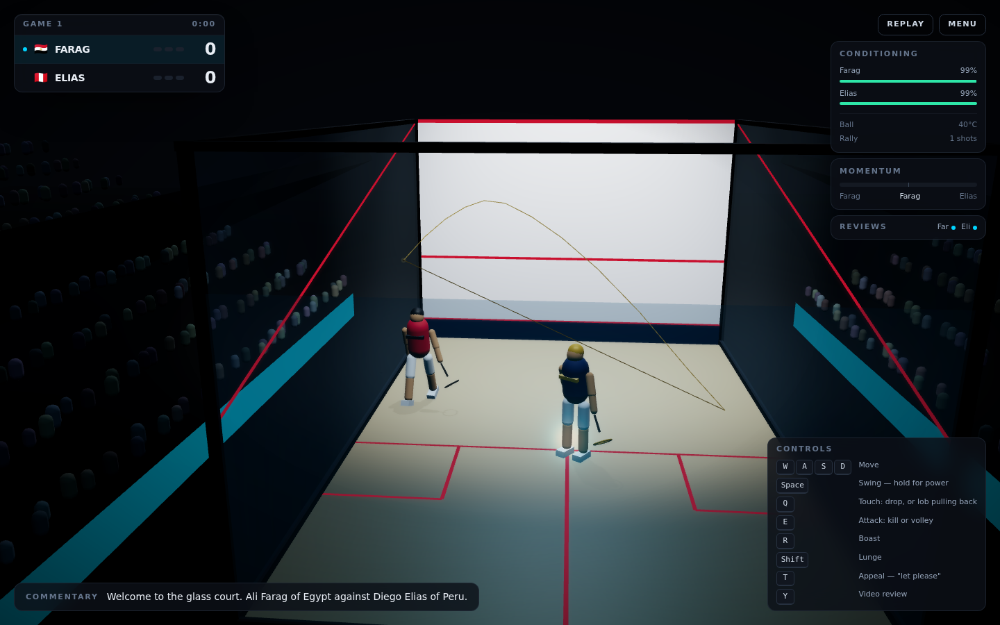

# Glass Court

A 3D squash simulation for the browser. Regulation WSF court, real ball physics,
the current rules — including lets, strokes and video review — a referee who has
to decide from what they actually saw, and a two-person commentary team calling
the match as it happens.

Player-versus-player is the primary mode: local on one keyboard or two gamepads,
or online through a room code.



---

## Running it

Two processes: Rails for the API and the WebSocket relay, Vite for the client.

```bash
# Backend
bundle install
bin/rails db:prepare
bin/rails server            # → localhost:3000

# Client (separate terminal)
cd client
npm install
npm run dev                 # → localhost:5173
```

Open **http://localhost:5173**. The Vite dev server proxies `/api` and `/cable`
back to Rails, so there is no CORS or host configuration to do.

For a production-style single-origin run, build the client into `public/` and
use Rails alone:

```bash
cd client && npm run build   # writes to ../public
bin/rails server             # → localhost:3000 serves everything
```

## Verifying it

```bash
bin/rails test               # 36 tests — rooms, matches, the cable relay
cd client
npm test                     # 43 tests — physics, rules, referee, determinism
npm run typecheck
npm run sim farag elias pro  # headless match, prints a broadcast report
npm run smoke                # drives the real app in a browser, screenshots each stage
npm run smoke:online         # two browsers, one room — verifies the netcode
```

`npm run sim` is the fastest way to see whether a change to the physics or the
rules broke the *feel* of the game rather than just its correctness:

```
  ── Match report ────────────────────────────────
  Result            Elias 1-3
  Games             11-9, 8-11, 9-11, 7-11
  Match time        22.9 min
  Rallies           104
  Avg rally         5.8 shots
  Longest rally     20 shots
  Fastest shot      176 km/h
  Ball temperature  33.2 °C now, 41.8 °C peak
  Referee           Roy Gingell  (lets 18, strokes 4, no lets 15)
  Rally outcomes    doubleBounce 58  let 29  down 22  noLet 15  stroke 9
```

---

## How it works

### The simulation is deterministic, and that decides the architecture

`client/src/engine/` is a pure TypeScript simulation with no dependency on the
DOM, three.js, the wall clock or `Math.random()`. It advances one 60 Hz tick at a
time from a pair of inputs and returns a list of events:

```ts
const events: SimEvent[] = sim.step([inputA, inputB]);
```

Given the same seed and the same input stream it produces bit-identical states on
every machine. Everything else in the project is a consumer of that:

| Consumer | What it does with the engine |
|---|---|
| `three/` | Reads state every frame in `useFrame`, never through React |
| `commentary/` | Turns the event stream into spoken lines |
| `audio/` | Turns the same events into synthesised sound |
| `engine/replay.ts` | Records states so time can be scrubbed |
| `net/` | Ships snapshots between peers |

Determinism is what makes the replay system exact rather than approximate, and
what lets an online guest predict locally instead of waiting for a round trip.

### Ball physics

The ball is integrated at 480 Hz with quadratic drag, Magnus lift from real
angular velocity, and swept collision against every court surface. Two details do
most of the work in making it feel like squash:

**Temperature.** A double yellow dot ball is nearly dead when cold and lively when
hot. Dropped from 100 in it rebounds about 12 in at room temperature and 26–33 in
at match temperature — a coefficient of restitution moving from ~0.35 to ~0.56.
Every impact deposits its lost kinetic energy into the rubber as heat, and the
ball cools continuously toward ambient. So a cold ball dies in the back corner and
rallies are short; a warm one sits up off the back wall and they stretch out. The
HUD shows the temperature because it genuinely changes how you should play.

**Spin.** Tangential impulses at each bounce are capped by Coulomb friction and
exchanged with the ball's angular velocity using the correct inertia for a hollow
sphere (`I = ⅔mr²`, giving a rolling impulse of `0.4·m·v_slip`). Cut on a drop
makes it check; a ball buried in the nick keeps almost nothing.

### Shots come from aiming, not from dice

`shots.ts` does what a player does: pick a target on a wall and try to hit it.
Execution quality — skill, timing, how stretched you are, how tired — perturbs
that aim point, with the height error biased downward. Errors then *fall out* of
the model. A stretched player attempting a drop from the back corner finds the tin
because their aim drifted down, not because a random number said so.

The launch solver solves for the launch **angle** at a requested speed rather than
solving for flight time. Eliminating *t* from the projectile equations gives a
quadratic in `tan θ`; the two roots are the flat and lofted trajectories. Drag is
then handled by aim-point correction — fly the solution forward, measure the miss,
move the target by it, repeat. (Solving for flight time instead silently caps
every shot at roughly `distance / time`, which is what made the game's "fastest"
drive 108 km/h before this was fixed.)

### Rules

Current WSF Rules of Squash as applied on the World Tour:

- **Point-a-rally to 11**, best of five, win by two from 10-all.
- **No second serve.** A fault loses the rally outright — but if the receiver
  attempts to return a fault, the service is deemed good (Rule 6.8), so the engine
  holds the call until the receiver's chance has gone.
- **Serve legality**: foot in the box, above the cut line, below the out line,
  landing in the opposite back quarter.
- **Interference** (Rule 8) as a real decision tree over measured geometry —
  access, view, swing, and the line to the front wall — producing let, stroke or
  no let with the specific sub-rule cited.
- **Conduct ladder**: warning → stroke → game → match.
- Tour tin at 430 mm; 480 mm available in settings.

### The referee rules on what they saw

The engine continuously measures interference geometry and keeps the worst moment
of each shot. When a player appeals, the referee does **not** rule on that record
directly — they rule on a *perturbed copy* of it, with the perturbation scaled by
how marginal the incident was and by that referee's own quality.

Video review then re-rules on the unperturbed truth. So reviews overturn marginal
calls far more often than obvious ones, which is exactly what happens on tour. One
review per game, retained if upheld.

Referees also differ: a strict official gives fewer strokes and warns earlier than
a lenient one, and you pick which one you get.

### The fourth dimension

One recorder feeds everything that involves time:

- **Instant replay** — cut automatically after a long rally or a stroke
- **Video review** — the referee's, at 0.18× with the court dimmed
- **Scrubbing** — drag the timeline; markers show every hit, bounce and decision
- **Hawk-Eye ribbon** — the exact recorded flight path, not an approximation
- **Momentum graph** — the whole match plotted, so you can see where it turned

### Commentary

Two voices plus the referee, sharing one microphone with a strict pecking order.
Candidate lines are scored per event and the best one wins; **everything else is
dropped rather than queued**. A backlog is what makes generated commentary sound
artificial — a line about a nick is worthless once the next rally is under way.

Lines react to real state: momentum swings, stamina, ball temperature, streaks,
shot speed, and how marginal a referee's call was. Voices come from the browser's
speech synthesis, separated by voice where the platform offers a choice and by
pitch and rate where it does not.

### Online play

Host-authoritative. One peer owns the simulation and is the single source of truth
for the ball, the score and every referee decision; the other sends inputs upstream
and renders interpolated snapshots at 20 Hz.

Squash is the right sport for this model: the ball is shared, contested and
physically subtle, so two peers each simulating independently would disagree about
who won the rally within a few exchanges — and there is no fair way to reconcile
that afterwards. What keeps it responsive for the guest is that the engine is
deterministic, so the guest predicts locally and the host's snapshot corrects it,
usually invisibly.

Rails is a **pure relay**. `MatchChannel` knows nothing about squash: it hands out
room codes, forwards a payload from one peer to the other, and stores results.
Keeping the server out of the simulation is why a rally is decided by physics
running locally at 60 Hz rather than by a round trip.

---

## Controls

The shot you play comes from a modifier plus the direction you are pushing, which
is how you actually think about squash — not from a menu of ten buttons.

| | Player one | Player two |
|---|---|---|
| Move | `W` `A` `S` `D` | Arrow keys |
| Swing (hold for power) | `Space` | `/` |
| Touch — drop, or **lob** pulling back | `Q` | `.` |
| Attack — kill, or **volley** in the air | `E` | `,` |
| Boast | `R` | `M` |
| Lunge | `Shift` | `R-Shift` |
| Appeal — "let please" | `T` | `P` |
| Video review | `Y` | `O` |

Gamepads work for either player. Left stick moves, right stick aims independently,
**A** swings, **X** touch, **B** attack, **Y** boast, **RB** lunge, **LB** appeal.

---

## Layout

```
app/                      Rails: rooms, match results, the cable relay
  channels/match_channel.rb   peer-to-peer relay, deliberately squash-agnostic
  models/{room,match}.rb      room codes, shared seeds, result validation
client/src/
  engine/                 the simulation — no DOM, no three.js, no randomness
    constants.ts            WSF court dimensions and physical constants
    ball.ts                 aerodynamics, swept collision, spin, temperature
    shots.ts                racket model and the launch solver
    player.ts               locomotion, swing state machine, stamina
    rules.ts                scoring and service law
    interference.ts         let / stroke / no let
    referee.ts              perception, video review, conduct
    ai.ts                   opponent — same inputs, same physics, no cheating
    world.ts                the tick
    replay.ts               the time dimension
  three/                  renderer: court, arena, players, ball, camera
  commentary/             phrase bank and the microphone
  audio/                  runtime-synthesised sound, speech synthesis
  net/                    ActionCable transport and REST client
  ui/                     React overlay, menus, replay deck
  data/roster.ts          playable characters
```

---

## A note on the roster

The playable characters are real professional squash players. Their names,
countries, career-high rankings and playing styles are used the way a fan project
uses them, and the attribute ratings are my own reading of how they play — every
value is read directly by the simulation, so a 97-touch player really does hit
better drops and a 99-stamina player really does last into the fifth.

The avatars are procedurally generated from primitives and are **not** likenesses.
Nothing here is affiliated with or endorsed by the PSA or any player. Shipping
this commercially would require licensing from both.

## Licence

MIT.
